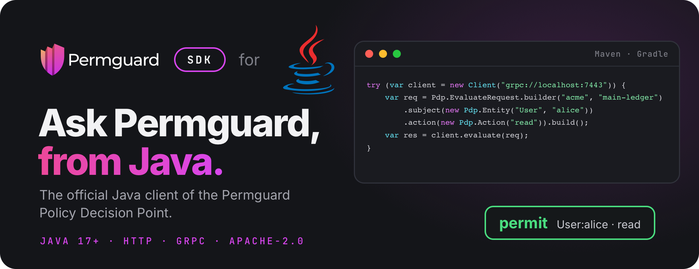

<!--
Copyright (c) 2022 Nitro Agility S.r.l.
SPDX-License-Identifier: Apache-2.0
-->

# Permguard Java SDK

[](https://central.sonatype.com/artifact/com.permguard.pep/permguard)
[](https://github.com/permguard/sdk-java/actions/workflows/sdk-java-ci.yml)
[](https://www.apache.org/licenses/LICENSE-2.0)

<p align="center">
  
</p>

<p align="center">
  <a href="https://github.com/permguard/permguard"><b>Permguard</b></a> ·
  <a href="https://docs.permguard.com/"><b>Documentation</b></a> ·
  <a href="#install"><b>Install</b></a> ·
  <a href="#quick-start"><b>Quick start</b></a> ·
  <a href="#develop"><b>Develop</b></a>
</p>

**The official Java client of the Permguard Policy Decision Point.**

Before your code acts, it asks Permguard whether a subject may perform an action on a resource, and Permguard answers from the policies of a ledger.
This SDK is how Java code asks: one client for the native, stateless PDP interface `permguard.api.pdp.native.v1`, over HTTP/JSON or gRPC, with the same request and the same answer on both.

<p align="center">
  
</p>

<p align="center"><sub>Your code asks, the SDK carries the question, the data plane decides with the ledger's policies.</sub></p>

## Install

The SDK needs Java 17 or newer, and is published on Maven Central.

Maven:

```xml
<dependency>
    <groupId>com.permguard.pep</groupId>
    <artifactId>permguard</artifactId>
    <version>0.1.1</version>
</dependency>
```

Gradle:

```kotlin
implementation("com.permguard.pep:permguard:0.1.1")
```

The badge above shows the latest release.
The SDK needs a Permguard data plane to ask: by default it listens on port `7443`, for HTTP and gRPC alike.
See the [Permguard repository](https://github.com/permguard/permguard) to run one.

## Quick start

```java
import com.permguard.Client;
import com.permguard.Pdp;
import com.permguard.Refusal;

public final class Check {
    public static void main(String[] args) {
        // grpc:// or grpcs:// speaks gRPC; http:// or https:// speaks JSON.
        try (var client = new Client("grpc://localhost:7443")) {
            var request = Pdp.EvaluateRequest.builder("acme", "main-ledger")
                    .profile("gateway")
                    .subject(new Pdp.Entity("User", "alice"))
                    .resource(new Pdp.Entity("Document", "budget-2026"))
                    .action(new Pdp.Action("read"))
                    .requestId("example-1")
                    .build();

            var response = client.evaluate(request);
            System.out.println("permitted: " + response.decision());
        } catch (Refusal refusal) {
            System.err.printf("refused: class=%s code=%s message=%s%n",
                    refusal.errorClass(), refusal.code(), refusal.getMessage());
        }
    }
}
```

The same program is in [example](example/src/main/java/com/permguard/example/Check.java); set `PERMGUARD_PDP_URL` to point it at another data plane.

### The request

| Builder method          | What it says                                                            |
| ----------------------- | ----------------------------------------------------------------------- |
| `builder(zone, ledger)` | the ledger whose policies decide, in its zone                           |
| `profile`               | the profile of the ledger's manifest that selects the partitions to run |
| `subject`               | who asks: a type and an id, with optional properties                    |
| `resource`              | what is acted on: a type and an id, with optional properties            |
| `action`                | what is done: a name, with optional properties                          |
| `context`               | any other fact the policies read                                        |
| `partitionInputs`       | runtime data for the partitions of the profile, see below               |
| `requestId`             | your id for the call, given back in the answer                          |

### The answer

A deny is not an exception: it is a successful response with `decision() == false`.
Validation, authorization, availability and server failures throw `Refusal`, with their stable `errorClass()` and `code()`.

## Partition inputs

Runtime data is addressed to the partition name the ledger's profile declares:

```java
var request = Pdp.EvaluateRequest.builder("acme", "main-ledger")
        .partitionInputs(Map.of(
                "authorization",
                new Pdp.PartitionInput(
                        "permguard.cedar.entities.v1",
                        List.of(Map.of(
                                "uid", Map.of("type", "Team", "id", "engineering"),
                                "attrs", Map.of("active", true),
                                "parents", List.of())))))
        .build();
```

The map key is a partition name from the selected profile.
`type` asserts the partition's input contract; it does not select a policy runtime.

## Many evaluations at once

Set the defaults on the request, list the evaluations, and call `evaluateMany`:

```java
var request = Pdp.EvaluateRequest.builder("acme", "main-ledger")
        .subject(new Pdp.Entity("User", "alice"))
        .evaluations(List.of(
                Pdp.Evaluation.builder()
                        .resource(new Pdp.Entity("Document", "budget-2026"))
                        .action(new Pdp.Action("read"))
                        .requestId("read")
                        .build(),
                Pdp.Evaluation.builder()
                        .resource(new Pdp.Entity("Document", "budget-2026"))
                        .action(new Pdp.Action("update"))
                        .requestId("update")
                        .build()))
        .options(new Pdp.EvaluationOptions(Pdp.EvaluationsSemantic.EXECUTE_ALL))
        .build();

var response = client.evaluateMany(request);
```

An evaluation whose `partitionInputs` is `null` inherits the request's.
An explicit empty map replaces them with no inputs, and the SDK keeps that difference on both transports.

## Endpoints and options

| Endpoint   | Transport                                      |
| ---------- | ---------------------------------------------- |
| `http://`  | JSON over HTTP                                 |
| `https://` | JSON over HTTPS                                |
| `grpc://`  | `permguard.data.v1.PolicyDecisionPoint`        |
| `grpcs://` | `permguard.data.v1.PolicyDecisionPoint` on TLS |

```java
var options = Client.Options.builder()
        .timeout(Duration.ofSeconds(5))
        .header("authorization", "Bearer " + token)
        .build();

try (var client = new Client("https://pdp.example.com", options)) {
    var configuration = client.getConfiguration();
}
```

| Option            | Sets                                        |
| ----------------- | ------------------------------------------- |
| `timeout`         | the timeout of every call                   |
| `header`          | a static header, also sent as gRPC metadata |
| `httpClient`      | the `HttpClient` used for HTTP              |
| `httpSslContext`  | the `SSLContext` for `https://`             |
| `grpcCredentials` | the `ChannelCredentials` for `grpcs://`     |

Every call also has an overload that takes its own timeout.
`getConfiguration` reads the data plane's discovery document.

## Compatibility

This major version implements `permguard.api.pdp.native.v1`.
Compatibility is tied to that versioned interface, not to a server minor version.

## Develop

```bash
mvn -f sdk/pom.xml test
mvn -f sdk/pom.xml package
./scripts/third-party-notices.sh --check
```

Maven generates the protobuf and gRPC sources from the checked-in native v1 contract at every build.

## License

Apache License 2.0: see [LICENSE](LICENSE), [NOTICE.md](NOTICE.md) and [THIRD_PARTY_NOTICES.md](THIRD_PARTY_NOTICES.md).

Permguard is a trademark of Nitro Agility S.r.l., see [TRADEMARKS.md](TRADEMARKS.md).
Java and the Java logo are trademarks of Oracle and/or its affiliates, shown only to name the language this SDK is for.
